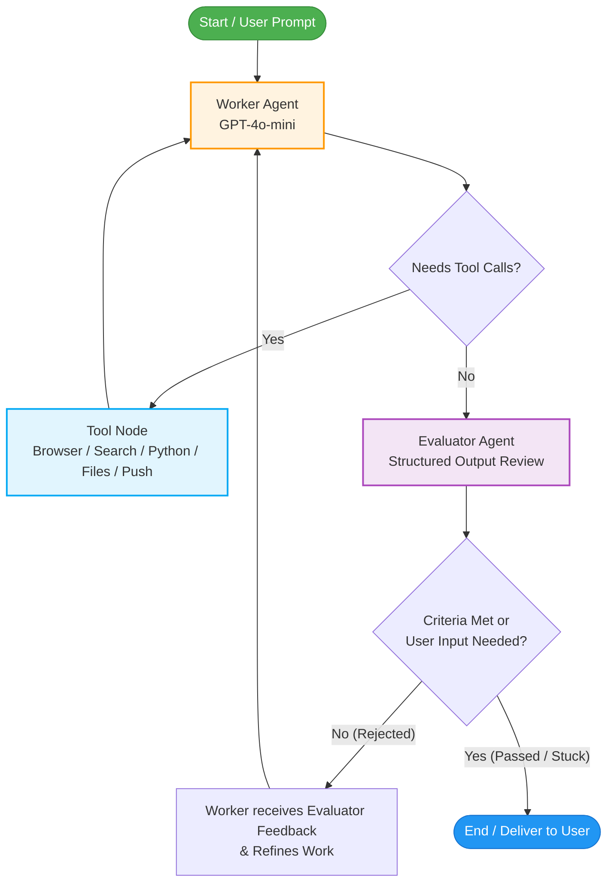

# 🚀 Sidekick

> **Autonomous, self-evaluating AI agent powered by LangGraph, LangChain, and Playwright.**

[](https://www.python.org/downloads/)
[](https://github.com/langchain-ai/langgraph)
[](https://github.com/langchain-ai/langchain)
[](https://playwright.dev/python/)
[](https://opensource.org/licenses/MIT)

**Sidekick** is an intelligent agentic assistant that doesn't just execute tasks—it **critiques, verifies, and refines** its own work. Built on top of **LangGraph**, it implements a robust **Evaluator-Optimizer loop** (Worker ⇄ Evaluator) paired with real-world tools: live browser automation, search engines, a Python execution sandbox, localized file system access, and mobile push notifications.

---

## 📑 Table of Contents

- [Key Features](#-key-features)
- [Architecture & Workflow](#-architecture--workflow)
- [Tool Ecosystem](#-tool-ecosystem)
- [Project Structure](#-project-structure)
- [Getting Started](#-getting-started)
  - [Prerequisites](#prerequisites)
  - [Installation](#installation)
  - [Environment Setup](#environment-setup)
- [Usage](#-usage)
  - [Interactive CLI](#1-interactive-cli)
  - [Programmatic API](#2-programmatic-python-api)
- [How It Works Under the Hood](#-how-it-works-under-the-hood)
  - [Agent State Schema](#agent-state-schema)
  - [Self-Correction Loop](#self-correction-loop)
  - [Evaluator Decision Schema](#evaluator-decision-schema)
- [Customization & Extension](#-customization--extension)
- [Troubleshooting](#-troubleshooting)
- [License](#-license)

---

## ✨ Key Features

- 🔄 **Evaluator-Optimizer Feedback Loop**: The Worker generates responses and runs tools, while an independent Evaluator validates the output against explicit success criteria before finalizing.
- 🎯 **Goal-Oriented Execution**: Every prompt can have explicit, measurable success criteria that guide agent convergence.
- 🌐 **Full Web Browsing**: Async Chromium browser automation with Playwright for interacting with dynamic web pages, SPAs, and complex DOMs.
- 🔍 **Real-Time Web Search**: Integrated Google Serper API for fast search queries.
- 🐍 **Dynamic Python REPL**: On-the-fly Python code execution for computations, data parsing, and scripting.
- 📁 **Sandboxed File Operations**: Scoped read/write/list file operations restricted to a dedicated `sandbox/` directory.
- 📲 **Mobile Push Notifications**: Immediate alerts sent directly to iOS/Android devices via the Pushover API.
- 🧠 **Persistent Conversation Memory**: State checkpointer powered by LangGraph's `MemorySaver` using unique thread sessions.
- 📊 **Production Observability**: Native support for LangSmith tracing and run monitoring.

---

## 🏗 Architecture & Workflow

Sidekick implements a cyclic state machine built with **LangGraph**:



### Execution Steps:
1. **Worker Node**: Generates reasoning steps or final answers using OpenAI GPT-4o-mini equipped with all registered tools.
2. **Tool Routing**: If the worker requests tool calls, execution shifts to `ToolNode` and returns tool outputs back into the conversation history.
3. **Evaluator Node**: When the worker produces an answer, the Evaluator analyzes the full trajectory against the `success_criteria`.
4. **Iterative Refinement**:
   - If criteria **fail**: The evaluator provides actionable feedback, injecting it into the worker's prompt for the next cycle.
   - If criteria **pass** or **user input is needed**: The graph terminates and returns results.

---

## 🧰 Tool Ecosystem

| Tool | Provider / Library | Description |
| :--- | :--- | :--- |
| **Playwright Browser** | `PlayWrightBrowserToolkit` | Autonomous web browsing (page visits, element clicks, form submissions, DOM scraping). |
| **Search** | `GoogleSerperAPIWrapper` | Real-time Google web searches. |
| **Wikipedia** | `WikipediaQueryRun` | Encyclopedic research and factual queries. |
| **Python REPL** | `PythonREPLTool` | In-memory Python code execution for calculations and data transforms. |
| **File Management** | `FileManagementToolkit` | Safe file manipulation (read, write, list) isolated to the `sandbox/` directory. |
| **Push Notification** | `requests` (Pushover API) | Mobile and desktop alerts when tasks complete or require attention. |

---

## 📁 Project Structure

```text
sidekick/
├── app/
│   ├── main.py             # Interactive CLI entry point with lifecycle management
│   ├── sidekick.py         # Sidekick class, StateGraph definition, worker & evaluator
│   ├── tools/
│   │   └── tools.py        # Tool implementations (Playwright, Serper, Python REPL, etc.)
│   └── graph/              # Module namespace for future graph extensions
├── pyproject.toml          # Project configuration, metadata, and dependencies
├── uv.lock                 # Deterministic dependency lockfile
├── .env.example            # Environment variable template
├── .gitignore              # Ignored patterns (virtualenv, credentials, bytecode)
└── README.md               # Project documentation
```

---

## 🚀 Getting Started

### Prerequisites

- **Python**: `>= 3.12`
- **uv** (recommended) or **pip**:
  ```bash
  # Install uv (if not already installed)
  curl -LsSf https://astral.sh/uv/install.sh | sh
  ```

### Installation

1. **Clone the repository:**
   ```bash
   git clone https://github.com/j-shifat-18/sidekick.git
   cd sidekick
   ```

2. **Create virtual environment and sync dependencies:**
   ```bash
   # Option A: Using uv (Recommended - handles environment and Python version automatically)
   uv sync

   # Option B: Using standard Python 3 venv
   python3 -m venv .venv
   source .venv/bin/activate
   pip install -e .
   ```

3. **Install Playwright browsers:**
   ```bash
   uv run playwright install chromium
   # or with active virtual environment:
   playwright install chromium
   ```

### Environment Setup

Copy `.env.example` to `.env` and fill in your credentials:

```bash
cp .env.example .env
```

| Variable | Required | Description | Where to get |
| :--- | :---: | :--- | :--- |
| `OPENAI_API_KEY` | **Yes** | OpenAI API key for `gpt-4o-mini` | [OpenAI Platform](https://platform.openai.com/api-keys) |
| `SERPER_API_KEY` | **Recommended** | Google Serper API key for online web search | [Serper.dev](https://serper.dev/) |
| `PUSHOVER_USER` | *Optional* | Pushover User Key for push alerts | [Pushover.net](https://pushover.net/) |
| `PUSHOVER_TOKEN` | *Optional* | Pushover Application Token | [Pushover.net](https://pushover.net/apps/build) |
| `LANGSMITH_TRACING` | *Optional* | Set to `true` for LangGraph execution traces | [LangSmith](https://smith.langchain.com/) |
| `LANGSMITH_API_KEY` | *Optional* | LangSmith API Key | [LangSmith](https://smith.langchain.com/) |
| `LANGSMITH_PROJECT` | *Optional* | Project name in LangSmith (e.g., `sidekick`) | [LangSmith](https://smith.langchain.com/) |

---

## 💻 Usage

### 1. Web UI Dashboard (Next.js + Tailwind CSS)

Sidekick features a modern, real-time web dashboard for interacting with the agent, monitoring the LangGraph state machine, and inspecting sandbox files:

```bash
# Terminal 1: Start the FastAPI Agent Backend
uv run uvicorn app.server:app --host 127.0.0.1 --port 8000

# Terminal 2: Start the Next.js Frontend
cd frontend
npm run dev
```

Then open **`http://localhost:3000`** in your browser.

#### Dashboard Capabilities:
- 🚀 **Mission Control**: Submit tasks with explicit success criteria and watch live streaming execution.
- 🛠 **Tool Execution Timeline**: Real-time cards for Playwright browsing, Google Serper queries, Python REPL computations, and Pushover alerts with collapsible parameter and output viewers.
- 📋 **Evaluator Critique**: Visual cards detailing how the auditor evaluated your criteria, displaying passed checks or self-correction loops.
- 🤝 **Human-in-the-Loop Prompt**: Direct input prompt when the agent pauses to request user clarification.
- 📁 **Sandbox File Explorer**: In-browser file viewer for reading, copying, and inspecting files created by the agent in `sandbox/`.
- 🗺 **LangGraph State Machine Map**: Interactive architectural diagram highlighting the active executing node in real-time.

---

### 2. Interactive Terminal CLI

Launch the terminal interface directly:

```bash
uv run python app/main.py
```

**Example CLI Session:**
```text
============================================================
🚀 Initializing Sidekick Autonomous Agent...
============================================================
✅ Sidekick ready! (Type 'exit' or 'quit' to stop)

👉 Enter your task: Research the latest breakthrough in quantum computing and save a summary.
🎯 Success criteria (optional, press Enter for default): Create a file named quantum.txt in sandbox/ with at least 3 key findings.

⏳ Sidekick is executing the task...

------------------------------------------------------------
🤖 Assistant:
I have researched the recent developments in topological quantum qubits and written a concise 3-point summary to sandbox/quantum.txt.

📋 Evaluator:
Evaluator Feedback on this answer: The assistant accurately researched the topic, created the requested file 'sandbox/quantum.txt', and included the 3 required findings. Success criteria met.
------------------------------------------------------------
```

### 2. Programmatic Python API

You can import and integrate `Sidekick` directly into your own scripts and services:

```python
import asyncio
from app.sidekick import Sidekick

async def main():
    agent = Sidekick()
    
    # 1. Initialize tools (starts browser) and compile graph
    await agent.setup()
    
    try:
        history = []
        
        # 2. Run a superstep with task and success criteria
        history = await agent.run_superstep(
            message="Find the current population of Tokyo and compute 15% of it.",
            success_criteria="The response must state Tokyo's current population and calculate exactly 15% of that number.",
            history=history,
        )
        
        # 3. Retrieve Assistant response and Evaluator verdict
        assistant_reply = history[-2]["content"]
        evaluator_feedback = history[-1]["content"]
        
        print("Assistant Output:", assistant_reply)
        print("Evaluator Verdict:", evaluator_feedback)
        
    finally:
        # 4. Clean up browser and background workers
        agent.cleanup()

if __name__ == "__main__":
    asyncio.run(main())
```

---

## 🔬 How It Works Under the Hood

### Agent State Schema

The graph maintains state across iterations using `State` (`TypedDict`):

```python
class State(TypedDict):
    messages: Annotated[List[Any], add_messages]  # Append-only message history
    success_criteria: str                         # Goal definition
    feedback_on_work: Optional[str]               # Evaluator critique from prior rejection
    success_criteria_met: bool                    # Flag indicating completion
    user_input_needed: bool                       # Flag indicating agent is blocked or requires user input
```

### Self-Correction Loop

When the Worker concludes its tool executions, it produces a draft answer. The **Evaluator** uses structured outputs powered by Pydantic:

```python
class EvaluatorOutput(BaseModel):
    feedback: str = Field(description="Feedback on the assistant's response")
    success_criteria_met: bool = Field(description="Whether the success criteria have been met")
    user_input_needed: bool = Field(description="True if more input is needed from user or assistant is stuck")
```

If `success_criteria_met == False` and `user_input_needed == False`:
1. The evaluator's critique is stored in `state["feedback_on_work"]`.
2. The conditional router routes back to `worker`.
3. The worker's dynamic prompt is augmented with:
   ```text
   Previously you thought you completed the assignment, but your reply was rejected because the success criteria was not met.
   Here is the feedback on why this was rejected:
   {state["feedback_on_work"]}
   With this feedback, please continue the assignment, ensuring that you meet the success criteria or have a question for the user.
   ```
4. The worker leverages its tools to address the shortcomings until the evaluator is satisfied.

---

## 🛠 Customization & Extension

### Adding New Tools
To register a new tool, define or import it in [`app/tools/tools.py`](file:///Users/shifat/projects/Agentic_Ai/sidekick/app/tools/tools.py) and include it in the `other_tools()` return list:

```python
from langchain_core.tools import tool

@tool
def calculate_travel_time(distance_km: float, speed_kmh: float) -> float:
    """Calculate travel time given distance in km and speed in km/h."""
    return distance_km / speed_kmh
```

### Changing Models
By default, Sidekick uses `gpt-4o-mini` for both worker and evaluator to maintain low latency and cost. You can switch to any LangChain-supported chat model in [`app/sidekick.py`](file:///Users/shifat/projects/Agentic_Ai/sidekick/app/sidekick.py#L49-L52):

```python
worker_llm = ChatOpenAI(model="gpt-4o", temperature=0.2)
evaluator_llm = ChatOpenAI(model="gpt-4o", temperature=0.0)
```

---

## ❓ Troubleshooting

- **Playwright Host/Browser issues**:
  Ensure chromium is installed via `playwright install chromium`. If running in a headless server or container, set `headless=True` in [`app/tools/tools.py`](file:///Users/shifat/projects/Agentic_Ai/sidekick/app/tools/tools.py#L23).
- **Missing `sandbox/` directory**:
  The file management toolkit isolates actions to `sandbox/`. The directory will automatically be created on file write operations.
- **Search fails or returns empty**:
  Verify that `SERPER_API_KEY` is correctly set in `.env` and that your Serper account has remaining query credits.
- **Import errors**:
  Ensure you are executing from the repository root using `uv run python app/main.py` or with your virtual environment activated.

---

## 📄 License

This project is licensed under the [MIT License](https://opensource.org/licenses/MIT).
